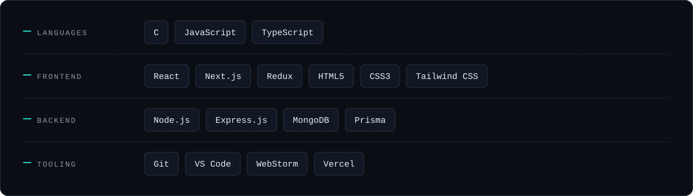
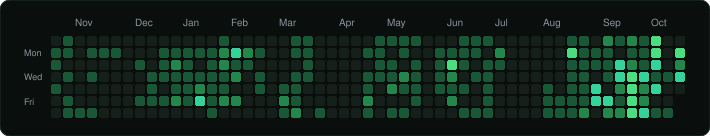

  

I build full-stack web applications with the MERN stack, and I care about the parts that don't show up in a demo: structure, naming, and how a codebase holds up as it grows.

**Building** &nbsp;&mdash;&nbsp; scalable web applications with MongoDB, Express, React and Node  
**Learning** &nbsp;&mdash;&nbsp; advanced JavaScript patterns and system architecture  
**For fun** &nbsp;&mdash;&nbsp; algorithmic problem solving  
**Reach me** &nbsp;&mdash;&nbsp; [sholayman.dev@gmail.com](mailto:sholayman.dev@gmail.com)

 

 

  
  

 

  &nbsp;
  &nbsp;
  &nbsp;
  &nbsp;
  

